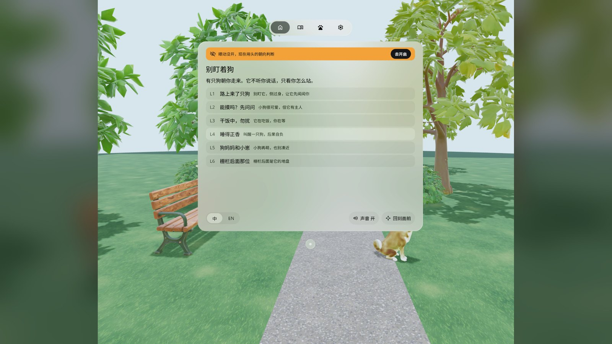
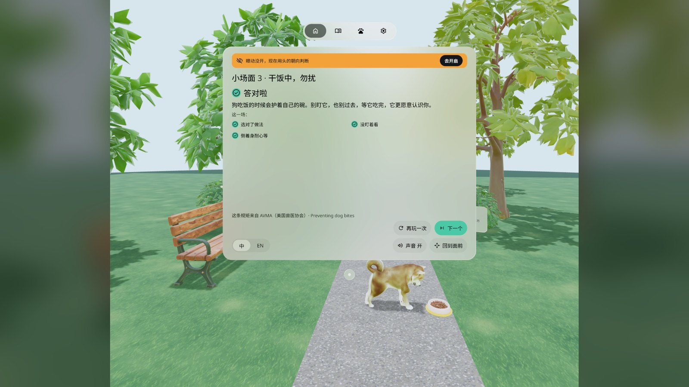
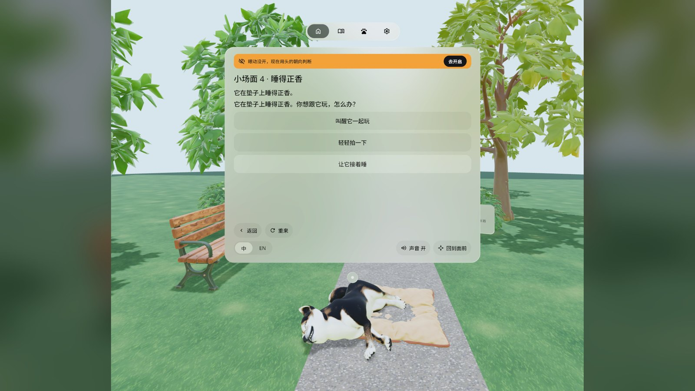
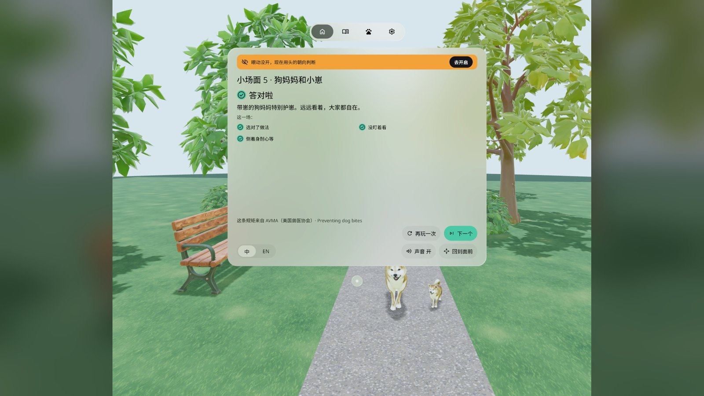
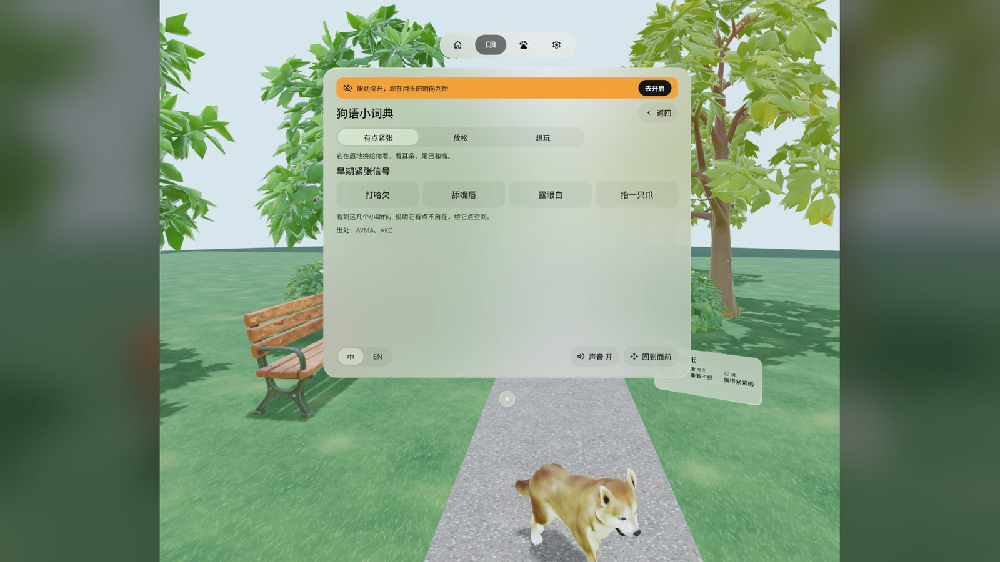
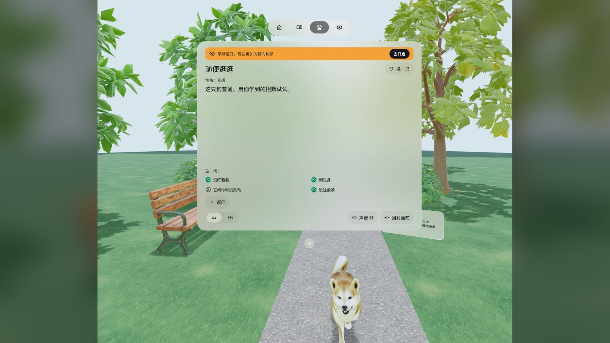

# Dog Manners 别盯着狗

> **v0.1.3 · checked on a PICO headset by the owner**（v0.1.3 · 已在 PICO 头显上由作者验收）


[English](#english) · [中文](#中文)

---

## English

A life-size Shiba Inu trots up a park path toward you. It doesn't listen to what you say. It watches how you stand. Stare at it and it gets wary; turn sideways and hold still and it relaxes, sniffs you and play-bows. Six short scenes teach you how to meet a strange dog, based on the AVMA (American Veterinary Medical Association) dog-bite prevention advice. A PICO OS 6 app built with the PICO Spatial SDK.

- **Six short scenes**: A dog on the path · Can I pet it? · Do not disturb: dinner · Let sleeping dogs lie · Mom and pup · The dog behind the fence
- **It reads your body, not your buttons**: where your face points, how long you stare (eye tracking if you allow it, head direction if not), whether you lean in or move suddenly
- **Forgiving checks**: a half turn of 25–30° counts as "sideways"; two near misses in a row loosen the check one step, and an amber hint tells you what's off
- **Signal tag** next to the dog spells out what its ears, tail and mouth are saying (wary / relaxed / playful)
- **Dog-speak cheat sheet** and **Just hang out** (a random dog of random size and temper walks up)
- A park in the dog's style: owner, trees, bench, fence, bowl and bed are 3D models lit by a park sky light and a sun with soft shadows
- Only the dog's own sounds (panting, paws, sniffing, a shake, a soft woof), no background noise
- Every scene ends with a short result card and its source; Chinese and English; sound on/off; Settings → Quit app
- Offline, no account. Optional permission: eye tracking (decline it and the app goes by head direction)

### Screenshots (emulator, Chinese UI, v0.1.3)

| | |
|---|---|
|  Stare at it and it stops, ears back (scene 1) |  Home: six short scenes, the Shiba out in the park |
|  Turn sideways and let it eat: Nailed it, source (AVMA) below |  Let sleeping dogs lie: pick what to do |
|  Mom and pup: watch from a distance, Nailed it |  Dog-signal guide: the early signs of a wary dog |
|  Just hang out: a random dog walks up | |

Screenshots come from the PICO emulator with states pinned by debug broadcasts. The square emulator frame sits on a blurred copy of itself to make 16:9. The demo video in the release (`DogManners-demo-v0.1.3.mp4`, 75 s) is a native emulator run **driven by debug input — not a recording of real hand gestures or a real person**. It has no sound, and the emulator only draws 2–5 frames a second at this resolution, so motion is choppy.

### Install

```bash
adb install -r DogManners-v0.1.3.apk
pico-cli app launch io.embodit.dogmanners
```

Get the APK from [Release v0.1.3](https://github.com/kejing-dev/DogManners/releases/tag/v0.1.3). Requires PICO OS 6 (Spatial SDK 6.1.9, minSdk 35). It is a debug build; uninstall an older build first if `install -r` reports a signature mismatch.

### Known issues (non-blocking)

Emulator QA round 2 (v0.1.1) passed all three gates. v0.1.2 and v0.1.3 were checked on a headset by the owner; the third emulator QA round was skipped. Open items:

1. The small labels on the signal tag (ears / tail / mouth) are still small when the dog stops 2 m away, even with the tag scaled ×1.5.
2. Scene 4, wrong pick: the result card's goal line reads "You picked the right move" next to a ✗, which reads oddly.
3. On the emulator the system window sometimes draws a black lower half; one [Bring back] fixes it. Not seen on the headset.
4. On the emulator the app shows a black screen for several seconds at launch; that's the emulator's frame rate.
5. Not separately checked: the window opening level when you start the app looking 30° down or up; the quit confirmation with a real ray click.

### Versions

- **v0.1.3**: no background sound at all (bed loop, far barks, passers-by, birds and the birdsong switch are gone; the collar jingle and the result chime too); the dog's own sounds are 3 dB quieter. New light: a park sky light (IBL) and one sun with shadows plus contact shadows, instead of glowing ground and flat fill. The window waits for a level head before it opens.
- **v0.1.2**: the owner, trees, bushes, bench, fence, bowl and bed are 3D models in the dog's style; painted grass and path; dog-park sounds; one system main window with the system tab bar and move bar.
- **v0.1.1**: forgiving checks, every branch ends, larger signal tag at 2 m; emulator QA round 2 passed.

### Development

Kotlin · PICO Spatial SDK 6.1.9 · Full Space Stage plus one system main window. See [AGENTS.md](AGENTS.md) for structure, debug broadcasts and the QA tour script. Domain logic (pressure model, forgiving checks, level gate) is plain Kotlin with 51 JVM tests.

### Credits

- Dog model: "Animated Dog, Shiba Inu" by quander, [CC BY 4.0](https://creativecommons.org/licenses/by/4.0/) (Sketchfab 9abfce885a834399b2c3ccaed51cd474). Clips re-keyed and coats recoloured by `tools/make_dog.py`.
- Park models (owner, trees, bushes, bench, fence, bowl, bed): Tripo text-to-3D in the author's own account, calibrated by `tools/make_park.py`.
- Fonts: Noto Sans / Noto Sans SC subset, SIL OFL 1.1 (`third_party/`).
- Icon glyphs: Material Symbols `visibility_off` + `pets`, Apache-2.0.
- Behaviour advice: AVMA dog-bite prevention; dog-signal guide also cites AKC. General advice only. With a real dog, listen to its owner.
- Sounds are rendered offline by `tools/make_sounds.py`.

---

## 中文

一只 1:1 的柴犬沿着公园的小路朝你走来。它不听你说话，只看你怎么站：盯着它，它就紧张；侧过身、站着别动，它才放松，过来闻闻你，再邀你玩。六个小场面，教你怎么跟陌生狗相处，规矩出自 AVMA（美国兽医协会）的防咬伤建议。PICO OS 6 应用，PICO Spatial SDK 开发。

- **六个小场面**：路上来了只狗 · 能摸吗？先问问 · 干饭中，勿扰 · 睡得正香 · 狗妈妈和小崽 · 栅栏后面那位
- **它读你的身体，不读按钮**：脸朝哪、盯了多久（允许眼动就用眼动，不允许就看头的朝向）、有没有往前凑、有没有突然乱动
- **判定宽容**：脸转 25–30° 也算侧过身；连着两次「差一点」自动放宽一档，琥珀条告诉你差在哪
- **信号牌**跟着狗，写出它的耳朵、尾巴、嘴在说什么（有点紧张 / 放松 / 想玩）
- **狗语小词典**和**随便逛逛**（随机大小、随机性格的狗走过来）
- 公园和狗同一种风格：主人、树、长椅、栅栏、狗碗、狗垫都是 3D 模型，公园天光照明，太阳投下柔和的影子
- 只有狗自己的声音（喘气、爪步、嗅闻、抖毛、轻轻一声汪），没有背景噪音
- 每个场面结束有一张结果卡，出处写在底下；中英双语；声音开关；设置 → 退出应用
- 不联网，不需要账号。可选权限：眼动追踪（拒绝后按头的朝向判断）

### 截图（模拟器，中文界面，v0.1.3）

见上方截图表：

1. 盯着它，它就停下，耳朵往后贴（小场面 1）
2. 首页：六个小场面，柴犬在公园里
3. 侧过身等它吃完：答对啦，出处 AVMA 写在底下
4. 睡得正香：它在垫子上睡觉，你选怎么办
5. 狗妈妈和小崽：远远看看就好，答对啦
6. 狗语小词典：有点紧张的早期信号
7. 随便逛逛：一只随机的狗朝你走来

截图来自 PICO 模拟器，状态用调试广播定住拍摄；模拟器画面是方的，左右用同图模糊补成 16:9。Release 里的演示视频（`DogManners-demo-v0.1.3.mp4`，75 秒）是原生模拟器演示，**由调试输入驱动，非真实手势录像**，无声；模拟器在这个分辨率下每秒只画 2–5 帧，动作是一顿一顿的。

### 安装

```bash
adb install -r DogManners-v0.1.3.apk
pico-cli app launch io.embodit.dogmanners
```

APK 在 [Release v0.1.3](https://github.com/kejing-dev/DogManners/releases/tag/v0.1.3)。需要 PICO OS 6（Spatial SDK 6.1.9，minSdk 35）。这是 debug 构建；`install -r` 报签名不一致时先卸载旧版。

### 已知问题（不挡用）

模拟器 QA 第 2 轮（v0.1.1）三道门禁全过；v0.1.2、v0.1.3 由作者戴头显验收，模拟器 QA 第 3 轮没跑。还开着的：

1. 狗停在 2 米外时，信号牌已放大 ×1.5，但小标签（耳朵 / 尾巴 / 嘴）还是偏小。
2. 小场面 4 选错时，结果卡的目标行写「选对了做法」配 ✗，读着别扭。
3. 模拟器上系统窗口偶尔下半截是黑的，点一次 [回到面前] 就好；头显上没见过。
4. 模拟器上启动有几秒黑屏，是模拟器帧率问题。
5. 没单独核对：低头 / 抬头 30° 启动时窗口是否摆平；退出确认用真实射线点击。

### 版本

- **v0.1.3**：彻底去掉背景声（底噪循环、远处狗叫、路人、鸟叫和「鸟叫」开关都删了，项圈叮当和结果提示音也删了），狗自己的声音再低 3 dB。光照重做：公园天光（IBL）+ 一盏带阴影的太阳 + 接触阴影，不再用地面自发光和平光补光。窗口等你平视再打开。
- **v0.1.2**：主人、树、灌木、长椅、栅栏、狗碗、狗垫换成和狗同风格的 3D 模型；手绘草地和小路；狗公园声音；一个系统主窗口（系统标签栏和移动条）。
- **v0.1.1**：判定放宽、所有分支都能结束、2 米外信号牌放大；模拟器 QA 第 2 轮通过。

### 开发

Kotlin · PICO Spatial SDK 6.1.9 · Full Space Stage 加一个系统主窗口。结构、调试广播、QA 巡检脚本见 [AGENTS.md](AGENTS.md)。判定逻辑（压力模型、宽容判定、平视门）是纯 Kotlin，51 条 JVM 单测。

### 致谢与许可

- 狗模型：quander 的「Animated Dog, Shiba Inu」，[CC BY 4.0](https://creativecommons.org/licenses/by/4.0/)（Sketchfab 9abfce885a834399b2c3ccaed51cd474），动画和毛色由 `tools/make_dog.py` 重做。
- 公园模型（主人、树、灌木、长椅、栅栏、狗碗、狗垫）：作者自己账号的 Tripo 文生 3D，`tools/make_park.py` 校准。
- 字体：Noto Sans / Noto Sans SC 子集，SIL OFL 1.1（`third_party/`）。
- 图标：Material Symbols `visibility_off` + `pets`，Apache-2.0。
- 行为建议出自 AVMA 防咬伤建议，狗语小词典另引 AKC。只是一般性建议，遇到真狗听主人的。
- 声音由 `tools/make_sounds.py` 离线渲染。
