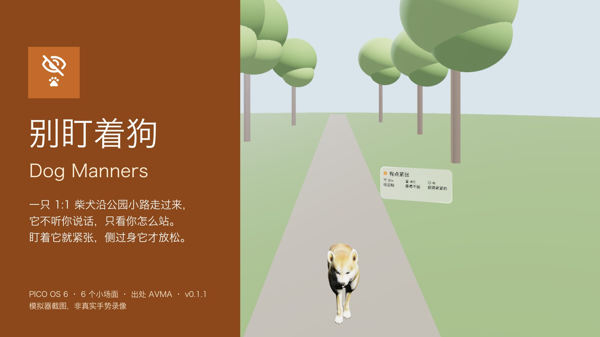
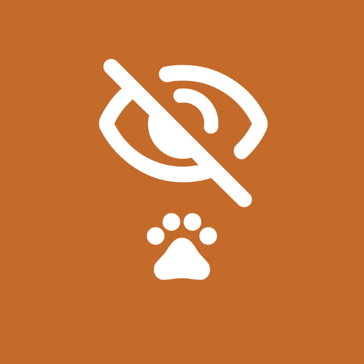
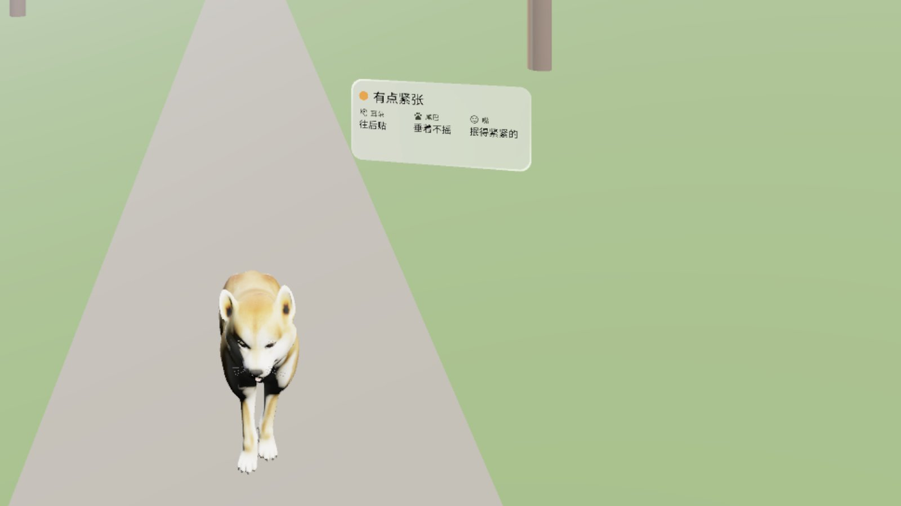
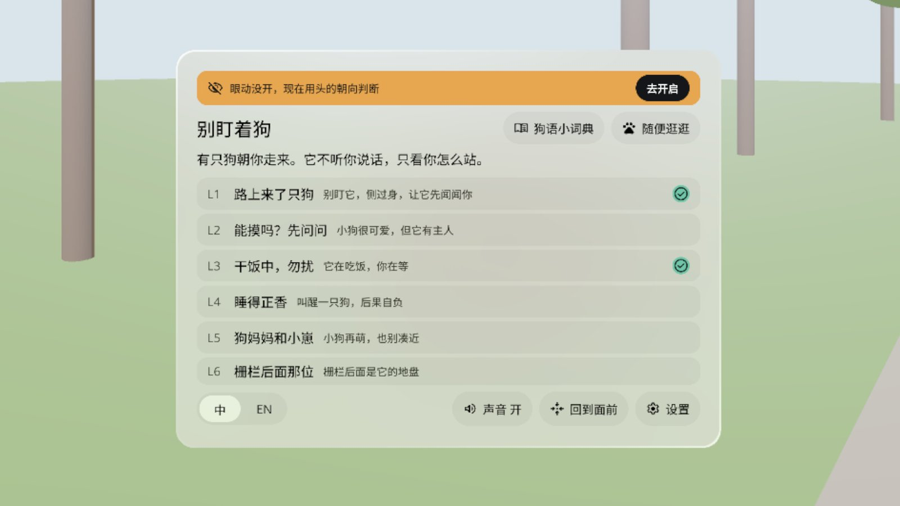
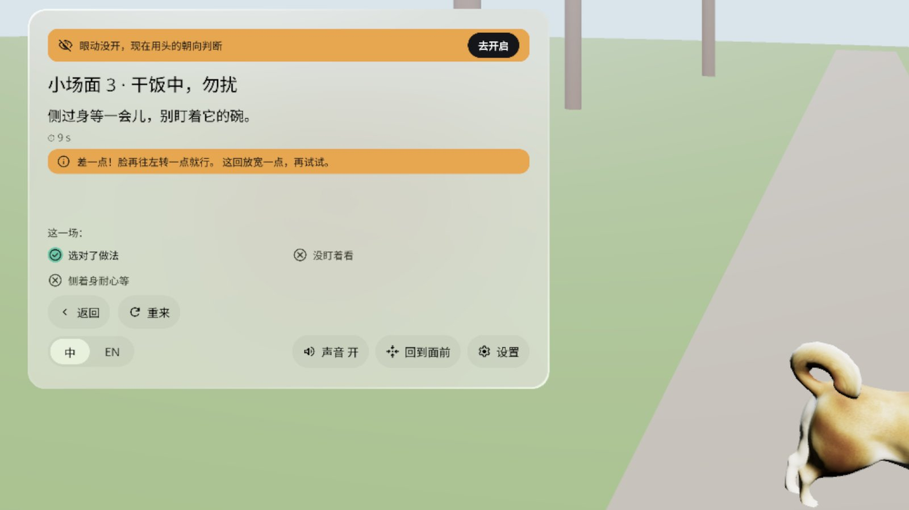
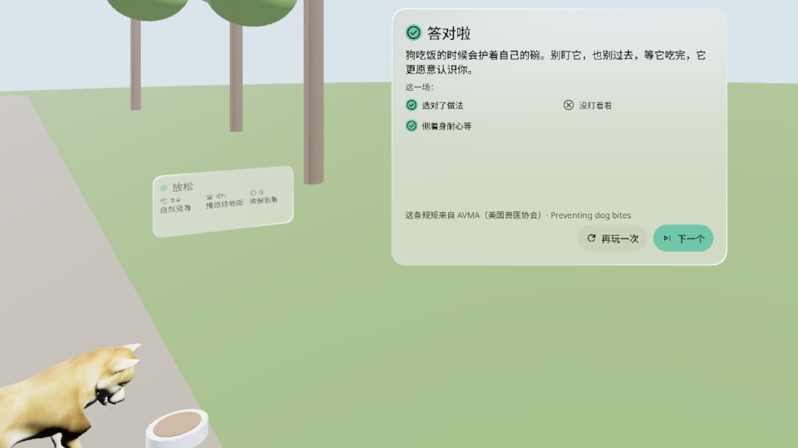
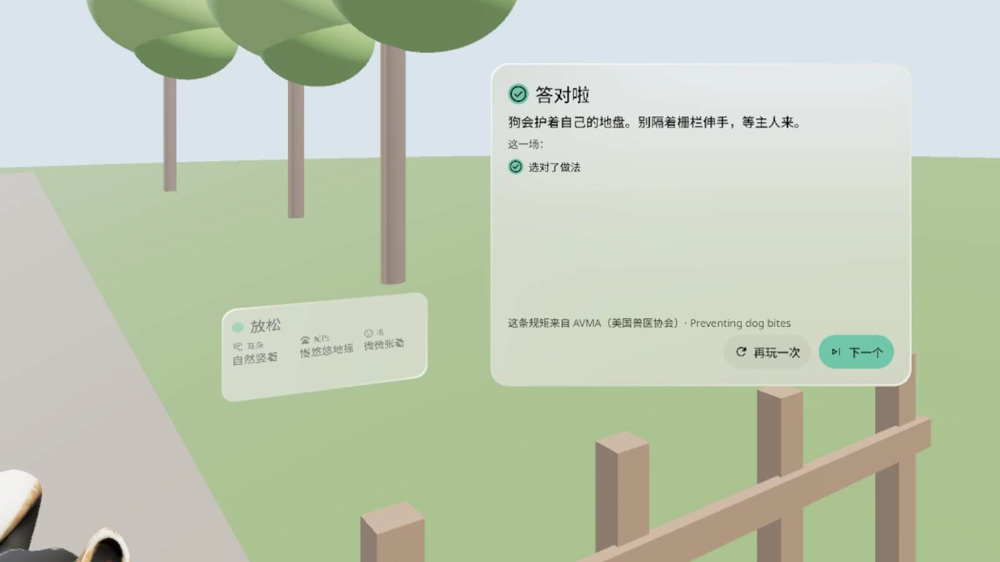
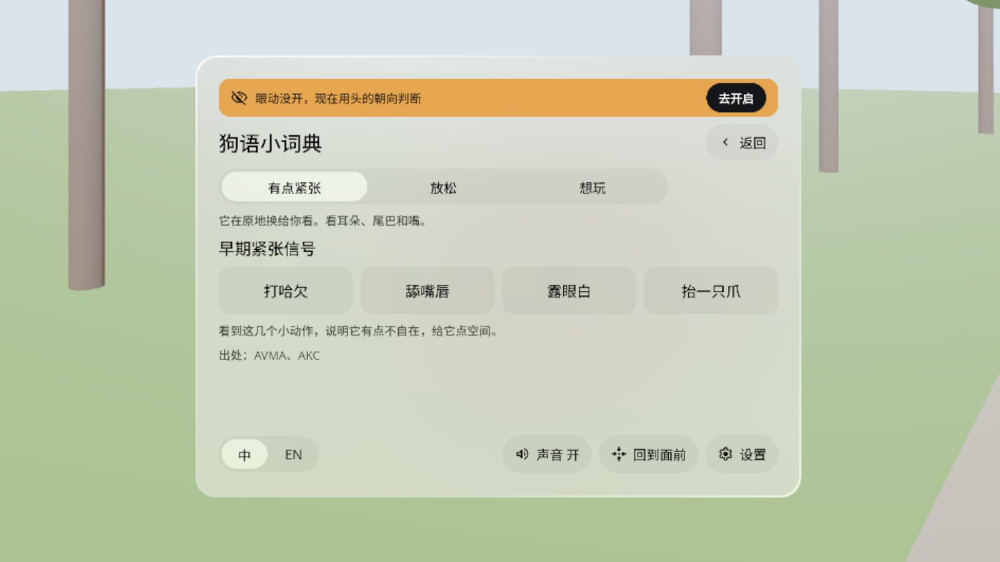

# Dog Manners 别盯着狗

> **v0.1.1 · Pre-release · passed emulator QA, not yet verified on a headset**（预发布 · 模拟器 QA 通过，真机未验证）





[English](#english) · [中文](#中文)

---

## English

A life-size Shiba Inu trots up a virtual park path toward you. It doesn't listen to what you say. It watches how you stand. Stare at it and it gets wary; turn sideways and hold still and it relaxes, sniffs you and play-bows. Six short scenes teach you how to meet a strange dog, based on the AVMA (American Veterinary Medical Association) dog-bite prevention advice. A PICO OS 6 app built with the PICO Spatial SDK.

- **Six short scenes**: A dog on the path · Can I pet it? · Do not disturb: dinner · Let sleeping dogs lie · Mom and pup · The dog behind the fence
- **It reads your body, not your buttons**: where your face points, how long you stare (eye tracking if you allow it, head direction if not), whether you lean in or move suddenly
- **Forgiving checks**: a half turn of 25–30° counts as "sideways"; two near misses in a row loosen the check one step, and an amber hint tells you what's off
- **Signal tag** next to the dog spells out what its ears, tail and mouth are saying (wary / relaxed / playful)
- **Dog-speak cheat sheet** and **Just hang out** (a random dog of random size and temper walks up)
- Every scene ends with a short result card and its source; Chinese and English; sound on/off; Settings → Quit app
- Offline, no account. Optional permission: eye tracking (decline it and the app goes by head direction)

### Screenshots (emulator, Chinese UI)

| | |
|---|---|
|  Stare too long and it gets wary; the signal tag says so |  Home: six short scenes, a dog-signal guide and free play |
|  Close-but-not-quite hints; two near misses loosen the check |  Turn sideways and let it eat: Nailed it, source (AVMA) below |
|  Big dog behind a fence: keep your hands back, wait for the owner |  Dog-signal guide: the small signs of wary, relaxed and playful |

Screenshots come from the PICO emulator with states pinned by debug broadcasts. The demo video in the release (`DogManners-demo-1080p.mp4`, 60 s) is a native emulator run **driven by debug input — not a recording of real hand gestures or a real person** — and has no sound.

### Install

```bash
adb install -r DogManners-v0.1.1.apk
pico-cli app launch io.embodit.dogmanners
```

Get the APK from [Release v0.1.1](https://github.com/kejing-dev/DogManners/releases/tag/v0.1.1). Requires PICO OS 6 (Spatial SDK 6.1.9, minSdk 35).

### Not yet verified on a headset

Emulator QA round 2 passed all three gates (no Material components; install + launch + 60 s with no crash / ANR; all 18 states captured and checked) and confirmed both round-1 blockers fixed. No headset was connected when this was published, so a person still needs to check on a real PICO:

1. Sloppy sideways turns: scenes 1, 3 and 5, three times each with controller and hands, turning the face only 25–30°. All should pass; three fails in a row is a blocker.
2. Whether the small labels on the signal tag (ears / tail / mouth) are readable with the dog 2 m away.
3. One full scene with real input (eye + pinch, controller ray) ends the same way as with debug commands.
4. Settings → Quit app → confirm with a real ray click: the app leaves recents and reopens on a clean home screen.
5. Three cold starts: panel and dog in front within 2 s; one cold start looking down 30° and one looking up 30°, panel upright and facing you.
6. With eye tracking allowed: staring at the dog for 1.5 s makes it wary and the gaze light shows.
7. Sound: 3 minutes with sound on is not annoying; audible from 1–3 m; mute is remembered.
8. A real object (a desk monitor) between you and the scene: dog and panels still fully visible and clickable.

### Known issues (non-blocking)

1. The small labels on the signal tag (ears / tail / mouth) are still small when the dog stops 2 m away, even with the tag scaled ×1.5; check on a headset.
2. Scene 4, wrong pick: the result card's goal line reads "You picked the right move" next to a ✗, which reads oddly.
3. On the emulator the app shows a black screen for 7–11 s at launch (up to 31 s to the home screen in QA). That's the emulator's frame rate; the real 2 s check needs a headset.
4. The quit confirmation was checked via its hit area plus a debug broadcast on the emulator, not a real ray click (macOS emulator has no spatial click injection).

### Development

Kotlin · PICO Spatial SDK 6.1.9 · Full Space Stage with three attachment panels. See [AGENTS.md](AGENTS.md) for structure, debug broadcasts and the QA tour script. Domain logic (pressure model, forgiving checks) is plain Kotlin with JVM tests: `DomainTest` 12 + `SloppyTest` 23.

### Credits

- Dog model: "Animated Dog, Shiba Inu" by quander, [CC BY 4.0](https://creativecommons.org/licenses/by/4.0/) (Sketchfab 9abfce885a834399b2c3ccaed51cd474). Clips re-keyed and coats recoloured by `tools/make_dog.py`.
- Fonts: Noto Sans / Noto Sans SC subset, SIL OFL 1.1 (`third_party/`).
- Icon glyphs: Material Symbols `visibility_off` + `pets`, Apache-2.0.
- Behaviour advice: AVMA dog-bite prevention; dog-signal guide also cites AKC. General advice only. With a real dog, listen to its owner.
- Sounds are synthesised in code.

---

## 中文

一只 1:1 的柴犬沿着虚拟公园的小路朝你走来。它不听你说话，只看你怎么站：盯着它，它就紧张；侧过身、站着别动，它才放松，过来闻闻你，再邀你玩。六个小场面，教你怎么跟陌生狗相处，规矩出自 AVMA（美国兽医协会）的防咬伤建议。PICO OS 6 应用，PICO Spatial SDK 开发。

- **六个小场面**：路上来了只狗 · 能摸吗？先问问 · 干饭中，勿扰 · 睡得正香 · 狗妈妈和小崽 · 栅栏后面那位
- **它读你的身体，不读按钮**：脸朝哪、盯了多久（允许眼动就用眼动，不允许就看头的朝向）、有没有往前凑、有没有突然乱动
- **判定宽容**：脸转 25–30° 也算侧过身；连着两次「差一点」自动放宽一档，琥珀条告诉你差在哪
- **信号牌**跟着狗，写出它的耳朵、尾巴、嘴在说什么（有点紧张 / 放松 / 想玩）
- **狗语小词典**和**随便逛逛**（随机大小、随机性格的狗走过来）
- 每个场面结束有一张结果卡，出处写在底下；中英双语；声音开关；设置 → 退出应用
- 不联网，不需要账号。可选权限：眼动追踪（拒绝后按头的朝向判断）

### 截图（模拟器，中文界面）

见上方截图表：

1. 盯得太久它就紧张：停下脚步，信号牌写着「有点紧张」
2. 首页：六个小场面，外加狗语小词典和随便逛逛
3. 差一点也有提示：连着两次差一点，判定自动放宽一档
4. 侧过身等它吃完：答对啦，出处 AVMA 写在底下
5. 栅栏后面的大狗：不伸手，等主人来
6. 狗语小词典：紧张、放松、想玩各有哪些小信号

截图来自 PICO 模拟器，状态用调试广播定住拍摄。Release 里的演示视频（`DogManners-demo-1080p.mp4`，60 秒）是原生模拟器演示，**由调试输入驱动，非真实手势录像**，无声。

### 安装

```bash
adb install -r DogManners-v0.1.1.apk
pico-cli app launch io.embodit.dogmanners
```

APK 在 [Release v0.1.1](https://github.com/kejing-dev/DogManners/releases/tag/v0.1.1)。需要 PICO OS 6（Spatial SDK 6.1.9，minSdk 35）。

### 模拟器 QA 通过，真机未验证

模拟器 QA 第 2 轮三道门禁全过（无 Material 组件；装机、启动、60 秒无崩溃 / ANR；18 个状态截图全部核对），第 1 轮打回的两条阻断复核已修。发布时头显没连，下面这些要戴上头显人工看：

1. 马虎侧身：小场面 1、3、5 各用手柄和手做 3 次，脸只转 25–30°，都应该能过；连续 3 次不过算阻断。
2. 狗停在 2 米外时，信号牌上的小标签（耳朵 / 尾巴 / 嘴）看不看得清。
3. 用真实输入（眼手捏合、手柄射线）走完一整个场面，结果和调试命令一致。
4. 设置 → 退出应用 → 用射线真点确认：应用从最近任务消失，再开是干净的首页。
5. 冷启动 3 次，2 秒内面板和狗都在正前方；低头 30°、抬头 30° 各冷启动一次，面板竖直、正对你。
6. 允许眼动后，盯着狗 1.5 秒它会紧张，目光光圈显示出来。
7. 声音：开着用 3 分钟不吵；1–3 米外听得见；静音开关记得住。
8. 在你和场景之间放一个真实物体（桌上的显示器），狗和面板照样完整可见、点得中。

### 已知问题（不挡用）

1. 狗停在 2 米外时，信号牌已放大 ×1.5，但小标签（耳朵 / 尾巴 / 嘴）还是偏小，要真机看。
2. 小场面 4 选错时，结果卡的目标行写「选对了做法」配 ✗，读着别扭。
3. 模拟器上启动黑屏 7–11 秒（QA 里到首页最长 31 秒），是模拟器帧率问题；2 秒出画面要真机核对。
4. 退出确认键在模拟器上只核对了可点区域并用调试广播走完流程，没做真实射线点击（macOS 模拟器没有空间点击注入）。

### 开发

Kotlin · PICO Spatial SDK 6.1.9 · Full Space Stage 加三块附着面板。结构、调试广播、QA 巡检脚本见 [AGENTS.md](AGENTS.md)。判定逻辑（压力模型、宽容判定）是纯 Kotlin，JVM 单测 `DomainTest` 12 条 + `SloppyTest` 23 条。

### 致谢与许可

- 狗模型：quander 的「Animated Dog, Shiba Inu」，[CC BY 4.0](https://creativecommons.org/licenses/by/4.0/)（Sketchfab 9abfce885a834399b2c3ccaed51cd474），动画和毛色由 `tools/make_dog.py` 重做。
- 字体：Noto Sans / Noto Sans SC 子集，SIL OFL 1.1（`third_party/`）。
- 图标：Material Symbols `visibility_off` + `pets`，Apache-2.0。
- 行为建议出自 AVMA 防咬伤建议，狗语小词典另引 AKC。只是一般性建议，遇到真狗听主人的。
- 声音全部由代码合成。
